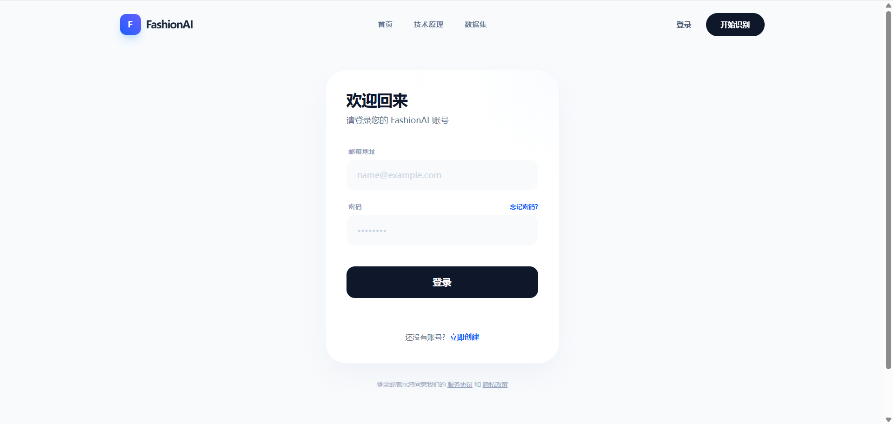
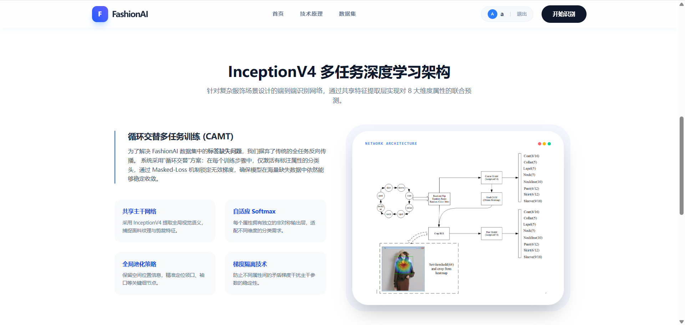
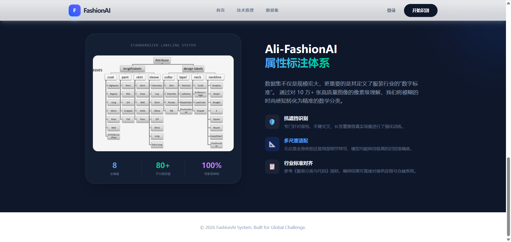

# Fashion AI 智能服饰属性分析系统

基于 **InceptionV4 多任务学习** 架构的深度学习项目。本项目实现了对服饰图像的高精度属性识别（如类别、颜色、领型、袖长等），并集成了基于 **FastAPI + SQLite** 的用户认证系统。

## 🌟 核心特性

* **多任务学习架构**：利用 InceptionV4 作为骨干网络，通过多个分支头同时识别多种服饰属性。
* **全栈交互体验**：现代化的 React + Tailwind CSS 前端，提供丝滑的拖拽上传与实时分析反馈。
* **安全认证体系**：基于 JWT (JSON Web Token) 的登录注册系统，密码采用 Bcrypt 哈希加密存储。
* **轻量化部署**：后端采用 SQLite 数据库，无需复杂的数据库配置即可快速启动。

---

## 🏗️ 技术架构
### 后端 (Backend)
* **Framework**: FastAPI (高并发异步框架)
* **AI Engine**: TensorFlow 2.15 + Keras
* **Computer Vision**: OpenCV, Pillow
* **Database**: SQLAlchemy + SQLite
* **Security**: JWT, Passlib (Bcrypt)

### 前端 (Frontend)
* **Library**: React 18 (TypeScript)
* **Styling**: Tailwind CSS (响应式设计)
* **Routing**: React Router DOM v6
* **State Management**: React Context API

---

## 🚀 快速开始

### 1. 克隆仓库
```bash
git clone [https://github.com/your-username/fashion-ai-system.git](https://github.com/your-username/fashion-ai-system.git)
cd fashion-ai-system

```

### 2. 后端配置

```bash
cd backend
python -m venv venv
source venv/bin/activate  # Windows: venv\Scripts\activate
pip install -r requirements.txt
python app/main.py

```

### 3. 前端配置

```bash
cd ../frontend
npm install
npm run dev

```

---

## 📊 模型与数据集

### 模型结构

系统采用 **InceptionV4** 网络进行特征提取。通过全局平均池化层后，接入多个独立的全连接层（Softmax/Sigmoid），实现对不同维度的属性分类。

### 训练数据集

模型基于 **DeepFashion** 数据集进行微调（Fine-tuning），该数据集包含丰富的服饰图像及对应的细粒度标签。

---
## 📸 界面预览

| 🔐 登录与注册 | 👕 图像分析主界面 |
| :---: | :---: |
|  |  |
| *支持 JWT 认证的安全登录系统* | *InceptionV4 实时多任务属性识别* |

| ⚙️ 技术细节看板 | 📱 响应式适配 |
| :---: | :---: |
|  |  |
| *模型架构与 Loss 曲线可视化* | *完美适配手机、平板等移动设备* |


## 🛠️ 待办事项 (Roadmap)

* [x] 基于 SQLite 的用户认证系统
* [x] InceptionV4 多任务推理逻辑整合
* [ ] 个人中心：用户历史识别记录查询
* [ ] 导出报告：支持下载 PDF 格式的分析报告
* [ ] 移动端 App 适配


## 📄 开源协议

本项目遵循 [MIT License](https://www.google.com/search?q=https://opensource.org/licenses/MIT)。


